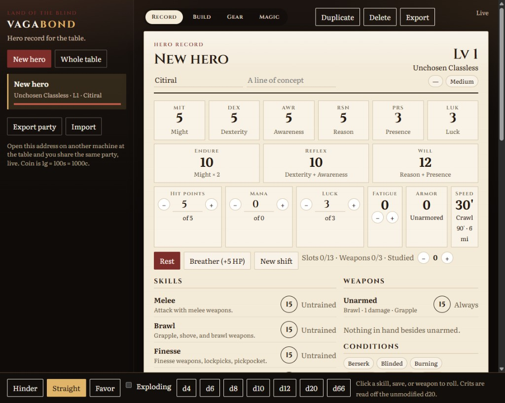

# Vagabond Character Sheet Editor

Extremely vibe coded, and made just for fun to help us in our campaign. Expect rough edges.

A shared character manager for [Vagabond](https://landoftheblind.myshopify.com/collections/vagabond-pulp-fantasy-rpg), the pulp fantasy RPG from Land of the Blind. It builds a hero from ancestry, class, stats, trainings, perks, spells, and gear, then tracks the numbers you touch in play: hit points, mana, luck, fatigue, wealth, and dice.

Open the same address on another machine at the table, sign in, and you see the same party, live. You edit the heroes linked to your account. A hero with no account can be claimed, and released if that was the wrong one. New accounts stay closed until the admin approves them at `/admin`. Heroes are saved on the server. With no database configured, they go in a local SQLite file. Set `DATABASE_URL` to use Postgres instead (as on Deno Deploy).

Rules data is original shorthand for use at the table, based on the Core Rulebook v3 alpha 3 preview. It is not a substitute for the book.



## Run

1. Install [Deno](https://deno.land/).
2. Create a `.env` file in this directory (copy `.env.example`) with these two variables:
   ```sh
   AUTH_SECRET=some-long-random-string
   ADMIN_EMAIL=you@example.com
   ```
   - `AUTH_SECRET` signs login tokens. It must be at least 16 characters, or the server exits on startup.
   - `ADMIN_EMAIL` is the account that is approved as soon as it registers and can approve everyone else at `/admin`.
3. Start the server:
   ```sh
   deno task start
   ```
4. Open http://localhost:8080/register and register with the same email as `ADMIN_EMAIL` to create the admin user.

Every other account stays pending until the admin approves it at `/admin`.

The party is stored in `data/vagabond.sqlite`. Delete the `data/` folder to start over with no accounts and no heroes.

Other optional environment variables:

- `PORT`: listen port, default `8080`.
- `DATABASE_URL`: Postgres connection string. When unset, the app uses SQLite.

## Test

```sh
deno task test
```
